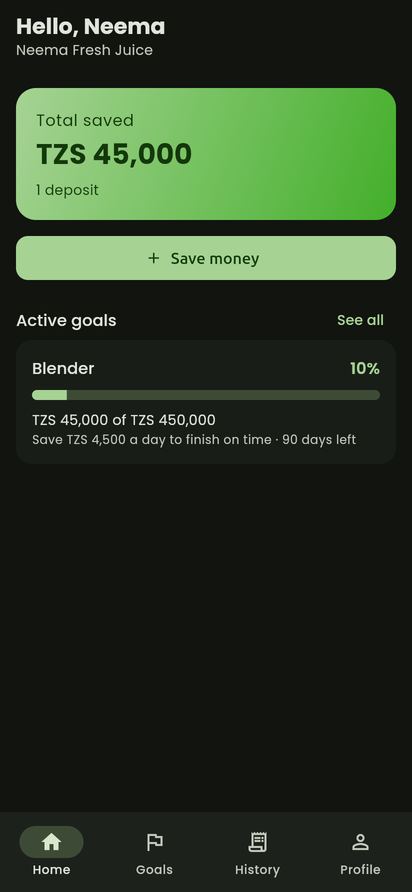
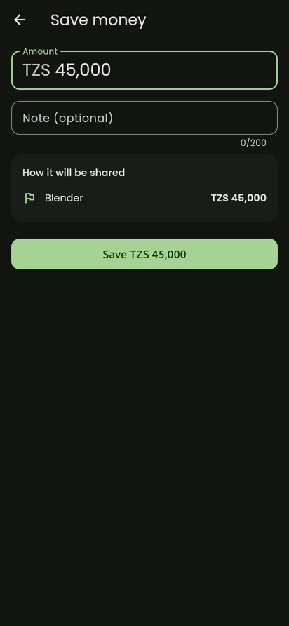
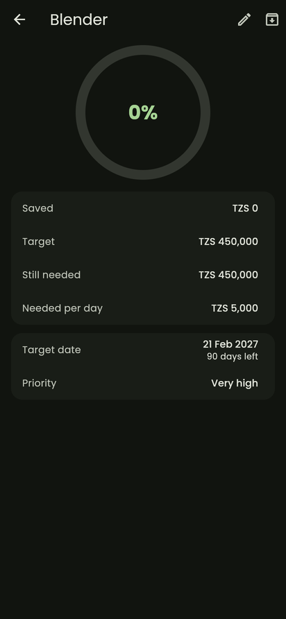

# Fanikisha

**Level up your saving habit.** Fanikisha ("make it succeed" in Swahili) helps
owners of small and medium businesses in Tanzania save towards goals such as
new stock, equipment or rent. Every deposit is split across the owner's goals
automatically, weighted by each goal's priority and how close its deadline is.

| Dashboard | Save money | Goal |
| --- | --- | --- |
|  |  |  |

> **Status:** being rebuilt. The new API is in [`api/`](api/) and the new app in
> [`mobile/`](mobile/). The Flutter app at the root (`lib/`) and the `backend/`
> server are the original 2022 training version, kept until the rebuild is
> finished. See the [roadmap](docs/ROADMAP.md).

## Repository layout

| Path | What it is |
| --- | --- |
| [`api/`](api/) | New backend: NestJS 12, PostgreSQL, Prisma. [Setup and API reference](api/README.md) |
| [`mobile/`](mobile/) | New app: Flutter, Riverpod, go_router; English and Kiswahili. [Setup and architecture](mobile/README.md) |
| [`docs/ROADMAP.md`](docs/ROADMAP.md) | Rebuild plan and progress |
| `lib/`, `backend/` | Original 2022 Flutter app and Express server (to be removed) |
