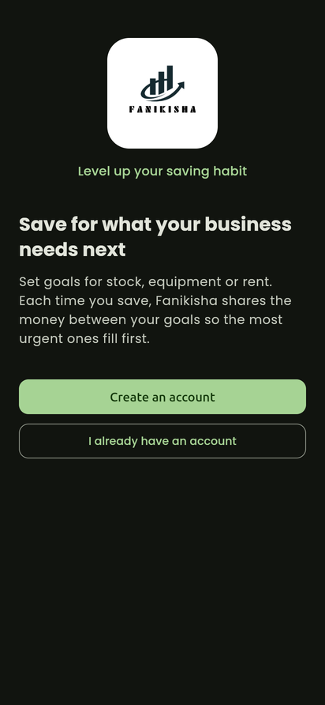
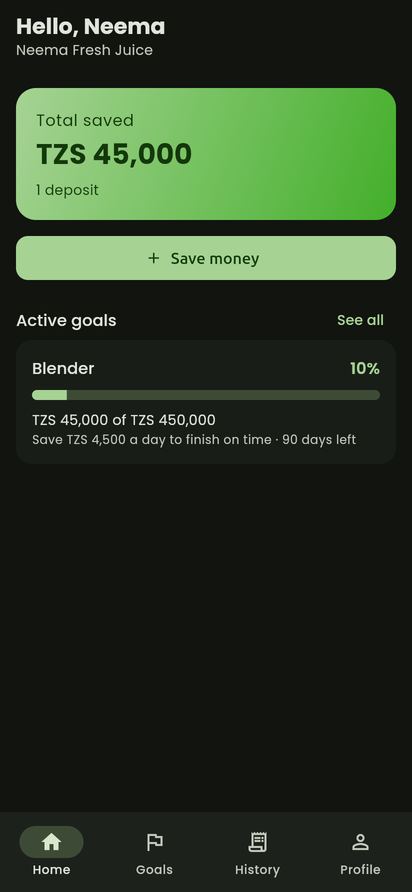
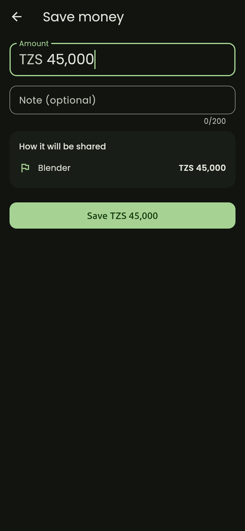
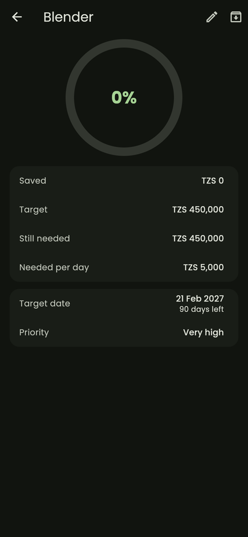
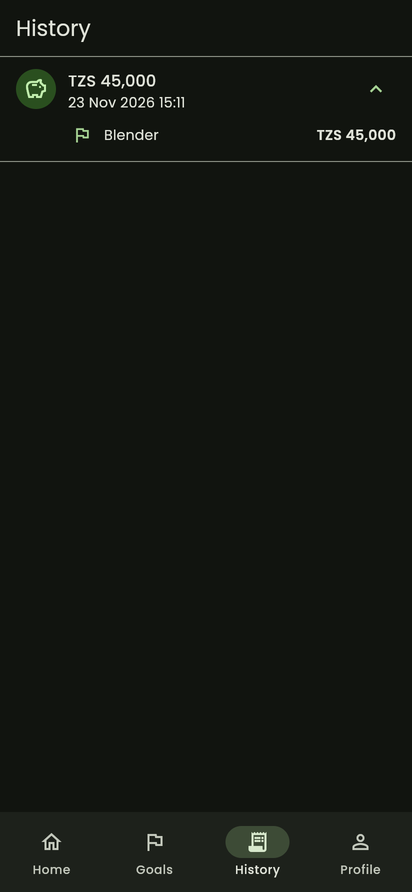

# Fanikisha mobile app

Flutter app for [Fanikisha](../README.md): savings goals for small and medium
business owners, in English and Kiswahili. It talks to the [Fanikisha API](../api/).

| Welcome | Dashboard | Save money | Goal | History |
| --- | --- | --- | --- | --- |
|  |  |  |  |  |

## What it does

- Sign up and log in; the session survives restarts and renews itself.
- Forgot password: reset with a code texted to the verified phone number.
- Dashboard with total savings and progress on active goals.
- Goals: create, edit, archive; each shows the daily amount needed to finish on time.
- Save money: shows how the amount will be split between goals before you
  confirm. A deposit retried after a dropped connection is recorded once.
- Deposit history with each deposit's split.
- Phone number verification by SMS code, with a reminder on the dashboard
  until it's done.
- Account deletion from the profile, confirmed with the password.
- Works offline for viewing: the last loaded dashboard, goals and history are
  shown with an "offline" banner. Saved data is cleared when signing out.
- English and Kiswahili, light and dark themes.

## How it's built

| Concern | Choice |
| --- | --- |
| State | [Riverpod 3](https://riverpod.dev) (`Notifier`, `AsyncNotifier`, `FutureProvider`) |
| Navigation | [go_router](https://pub.dev/packages/go_router), with a redirect guarding signed-in routes |
| HTTP | [Dio](https://pub.dev/packages/dio) in `ApiClient`: adds the access token, refreshes it once on a 401 (shared by concurrent requests), and signs out only when the refresh token is refused |
| Tokens | Android Keystore / iOS Keychain via `flutter_secure_storage` |
| Translations | `flutter gen-l10n` from `lib/l10n/app_en.arb` and `app_sw.arb` |

```
lib/
  core/         API client, providers, router, theme, formatting, shared widgets
  features/
    auth/       sign up, log in, session state
    dashboard/
    goals/
    savings/    deposits, preview, history
    profile/    profile, password, language
  l10n/         translations (the .arb files are the source)
```

## Running it

Start the API first (see [api/README.md](../api/README.md)), then:

```bash
flutter pub get
flutter run                     # Android emulator: reaches the API at 10.0.2.2:3000
flutter run --dart-define=API_BASE_URL=http://192.168.1.20:3000   # a phone on your Wi-Fi
```

Debug builds may use plain HTTP to `10.0.2.2` and `localhost` only; release
builds require HTTPS.

## Tests

```bash
flutter analyze
flutter test                    # unit and widget tests, no server needed
```

The integration test drives the real app against a running API. On Linux
(needs `libsecret-1-dev`; `xvfb-run` for a headless machine):

```bash
xvfb-run -a flutter test integration_test -d linux \
  --dart-define=API_BASE_URL=http://localhost:3000 \
  --dart-define=SCREENSHOT_DIR=/tmp/fanikisha-shots   # optional: saves a PNG per step
```

It signs up a new account each run, so it is safe on a development database.

## Release builds

Release builds are signed with an upload key that stays out of git.

1. Create the key once, outside the repository:

   ```bash
   keytool -genkeypair -v -keystore ~/fanikisha-upload.jks \
     -keyalg RSA -keysize 2048 -validity 10000 -alias upload
   ```

   Back up the file and its password in two safe places (e.g. a password
   manager and an offline copy). With Google Play App Signing a lost upload
   key can be replaced through Play support, but it takes time.

2. Create `android/key.properties` (git-ignored):

   ```properties
   storeFile=/home/you/fanikisha-upload.jks
   storePassword=...
   keyAlias=upload
   keyPassword=...
   ```

3. Build, with the deployed API's HTTPS address:

   ```bash
   flutter build appbundle --release \
     --dart-define=API_BASE_URL=https://api.example.com
   ```

Without `key.properties` the release build is signed with the debug key (so
`flutter run --release` works) and cannot be published. A release build with
a non-HTTPS `API_BASE_URL` refuses to start.

## Icon and splash screen

Made from the Fanikisha logo; the source images are in `assets/branding/`.
After changing them, regenerate the platform files:

```bash
dart run flutter_launcher_icons
dart run flutter_native_splash:create
```

`flutter_launcher_icons` can rewrite an unrelated iOS build setting
(`ASSETCATALOG_COMPILER_GENERATE_SWIFT_ASSET_SYMBOL_EXTENSIONS`): keep it `YES`.

## Translations

Edit `lib/l10n/app_en.arb` and `lib/l10n/app_sw.arb` (every key in both), then
`flutter gen-l10n`. The Kiswahili text would benefit from review by a native speaker.
